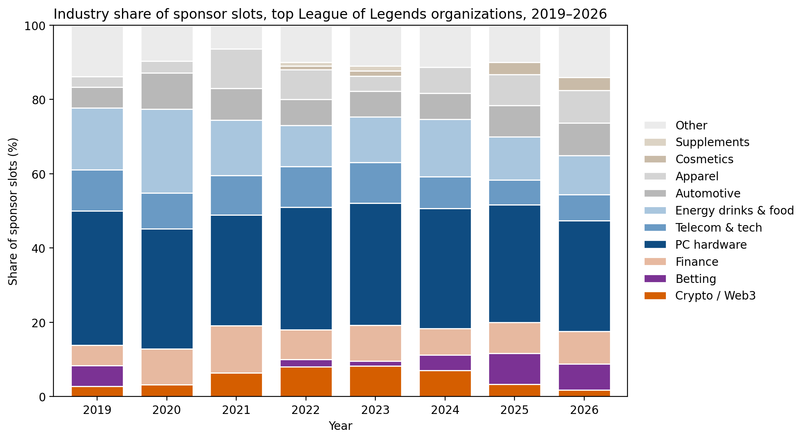
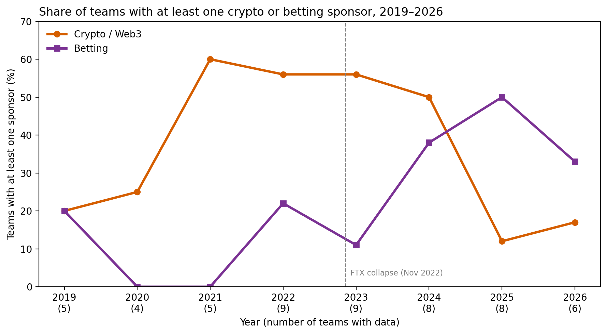

# Who Pays the Teams? Sponsorship in League of Legends Esports, 2019–2026

**Michael Chow**

## Research question

Which industries sponsored top League of Legends organizations from 2019 to 2026, and which categories were most prominent over time? Sponsorship is the main source of revenue for most esports teams, so who pays them shapes what they can do. Using archived copies of the "Partners" and "Sponsors" pages of 10 long-running franchise organizations (Team Liquid, Cloud9, FlyQuest, G2 Esports, Fnatic, Team Vitality, SK Gaming, T1, Gen.G and Dplus KIA) from the Internet Archive's Wayback Machine, I will code every sponsor by industry and track how the mix changed. I expect energy drink and hardware brands early on, a crypto and Web3 surge in 2021–2022, a drop after the FTX crash, and a rise in betting and prediction market sponsors from late 2024. Full details are in [`proposal.md`](proposal.md).

## Data

**Source.** Archived copies of each organization's partner or sponsor page in the [Internet Archive's Wayback Machine](https://web.archive.org/). I found the pages and their captures with the [Wayback CDX API](https://github.com/internetarchive/wayback/tree/master/wayback-cdx-server) and downloaded each selected capture in its original archived form (`/web/<timestamp>id_/<url>`). The team websites themselves were never contacted.

**Collection.** I ran [`collect_and_clean.ipynb`](collect_and_clean.ipynb) on **November 8, 2026**, making **266** requests (154 CDX searches and 112 page downloads). Every request sent a User-Agent naming the project with a contact address, paused between requests (5 seconds in that first run), backed off on errors, and was cached so nothing was downloaded twice. The notebook's collection code adapts the class's Week 7 Wayback Machine notebook (`get_with_retry`, `fetch_raw_capture`, the CDX-to-DataFrame steps), and those cells are marked.

**Records.**

| | Count |
| --- | --- |
| Organizations with at least one capture | 9 of 10 (none found for Dplus KIA) |
| Captures selected (2 per organization per year, 2019–2026) | 112 of 160 (48 missing) |
| Captures from the target months (Jan–Feb, Nov–Dec) | 81 |
| Raw sponsor mentions parsed | 2,393 |
| Clean rows (organization × year × period × sponsor) | 736 (after removing 417 rows coded `not_a_sponsor`) |
| Distinct sponsors | 151 |

**Cleaning.** Sponsor names come from logo link domains (`redbull.com` → `redbull`), logo alt text, or the logo's image file name (`Monster_Energy_Horizontal_Logo_500x.png` → Monster Energy). Teams' own short links that wrap a sponsor logo (`c9.gg/secretlab`) count as that sponsor. Spellings are merged with [`data/brand_aliases.csv`](data/brand_aliases.csv), duplicates on a page are counted once, and each sponsor is hand-coded into an industry in [`data/industry_codes.csv`](data/industry_codes.csv). Logos and links that aren't sponsors (game icons, website menu images, players, the teams' owners, press links) are coded `not_a_sponsor` and removed. Claude made a first-pass industry coding, and I reviewed and corrected every code by hand. Every field is described in [`data/data_dictionary.md`](data/data_dictionary.md).

**In this repository:** a 60-row sample of the clean dataset ([`data/sample/sponsors_sample.csv`](data/sample/sponsors_sample.csv)), the list of every capture used ([`data/sample/captures.csv`](data/sample/captures.csv)), and the hand-coding files.

**Left out, and why:**
- **Archived HTML pages (`data/raw/html/`).** The pages are the teams' copyrighted website content, served by the Internet Archive for viewing and research, not for redistribution. They are also large. Anyone can view each page through the `snapshot_url` in the data.
- **Raw CDX responses and parsed mentions (`data/raw/cdx/`, `data/interim/`).** These are intermediate files that the notebook rebuilds. Some pages include player names and photos in banners, and only brand names are kept.
- **The full clean dataset (`data/clean/`).** The assignment asks for a sample. The notebook rebuilds the full file in seconds from its cache, or in about 20–30 minutes from scratch.

## Methods

All analysis is in [`analysis.ipynb`](analysis.ipynb), which reads the clean data built by `collect_and_clean.ipynb`.

- **Unit of analysis.** A *sponsor slot* is one sponsor of one team in one year. A sponsor counts once per team per year if it appears in the early or the late capture, so a sponsor that stayed all year is not counted twice.
- **Fair comparison across years.** The number of teams with usable data changes by year (4 to 9; 475 sponsor slots in total), so I compare shares rather than raw counts: each industry's share of a year's sponsor slots, and the share of teams with at least one sponsor in an industry.
- **Industry coding.** Each sponsor is coded into one of eleven industries (crypto/Web3, betting and prediction markets, finance, PC hardware and peripherals, telecom and tech, energy drinks and food, automotive, apparel, cosmetics, supplements, other) in [`data/industry_codes.csv`](data/industry_codes.csv). Crypto casinos and skin-gambling sites count as betting.
- **Analyses (from the proposal).** (1) Industry share of sponsor slots by year; (2) crypto and betting sponsors per year, overall and by region; (3) new sponsors: a sponsor is new in the first year it appears on a team's page (each team's first year with data is left out), counted by industry.

## Findings

*Preliminary: based on 9 teams and 475 sponsor slots; see the limitations below.*

**1. PC hardware is the steady core of sponsorship, but the old "hardware and energy drinks" mix is shrinking.** PC hardware and peripherals hold 30–36% of sponsor slots in every year. Together with energy drinks and food, they fall from 53–55% of slots in 2019–2020 to 40–43% in 2025–2026, as cosmetics, supplements and "other" brands grow.



*Figure 1. Each bar splits one year's sponsor slots across industries, with crypto/Web3 and betting at the bottom so their rise and fall is easy to compare.*

**2. Crypto surged as expected, but it fell about two years after FTX, not right away.** The share of teams with at least one crypto/Web3 sponsor rose from 20–25% in 2019–2020 to 56–60% in 2021–2023 (Coinbase, Crypto.com, Polygon, Metaplex, Tezos, Socios). It was still 50% in 2024, then dropped to 12–17% in 2025–2026. This partly surprised me: multi-year deals kept crypto logos on pages after the FTX collapse in November 2022, and Team Liquid even added a new crypto sponsor (Sui) in 2024.

**3. Betting replaced crypto from 2024.** At most 22% of teams had a betting sponsor in any year from 2019 to 2023 (none in 2020–2021). That rose to 38% in 2024 and 50% in 2025, with Duelbits, Betpanda, Winamax, Betify, GG.BET and skin-gambling sites such as Skin.Club. In 2025, betting overtook crypto for the first time (50% vs. 12% of teams). 2026 shows 33%, but that year is incomplete.



*Figure 2. The percentage of teams (number with data under each year) that list at least one crypto/Web3 or betting sponsor on their partner page; the dashed line marks the FTX collapse in November 2022.*

**4. The shift is European and North American, not Korean.** Most betting slots come from European teams (4 in 2025, 3 in 2026, compared with 1 a year in North America), and Europe's crypto slots fell from 5 in 2022 to 0 in 2025–2026. The Korean teams' pages (T1, Gen.G) list no crypto or betting sponsors in any year.

**5. New deals follow the same pattern.** Teams add 10–15 new sponsors a year. New crypto sponsors appear only in 2021–2022 (3 a year) plus one in 2024, while new betting sponsors cluster in 2024–2026.

**Limitations.** Coverage is uneven: Dplus KIA has no archived partner page, Gen.G has four years of data, and only 4–5 teams have data in 2019–2021, so a single team moves a percentage by 20–25 points. A partner page shows that a sponsor is present, not how much it pays. Industry codes are my judgment, and 2026 only runs through early November.

## How to reproduce

```bash
pip install -r requirements.txt
jupyter notebook collect_and_clean.ipynb   # run all cells first: collects and cleans the data
jupyter notebook analysis.ipynb            # then run all cells: tables and figures/
```

A first run takes about 20–40 minutes because of the pause between requests; reruns use the saved files and take about a minute. `analysis.ipynb` also saves `data/clean/for_charts/team_year_sponsors.csv` for Power BI. To rerun the original test request: `python3 code/retrieve_one_record.py`.

## Repository contents

| Path | What it is |
| --- | --- |
| `proposal.md` | Project proposal |
| `collect_and_clean.ipynb` | Collection and cleaning notebook |
| `analysis.ipynb` | Analysis notebook: tables and figures |
| `figures/` | Saved figures |
| `report.md` | Final write-up (placeholder) |
| `code/` | Test CDX request from the proposal |
| `data/` | Data sample, hand-coding files and data dictionary |
| `requirements.txt` | Python packages needed |
